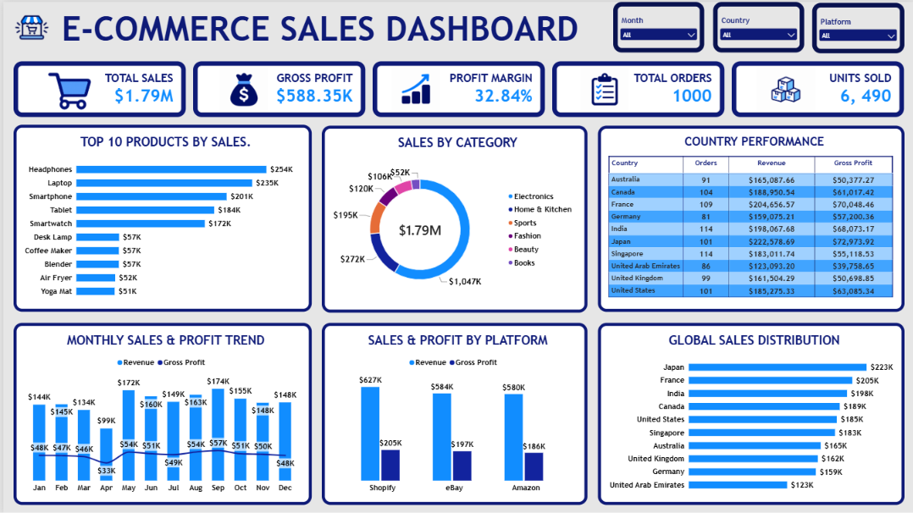
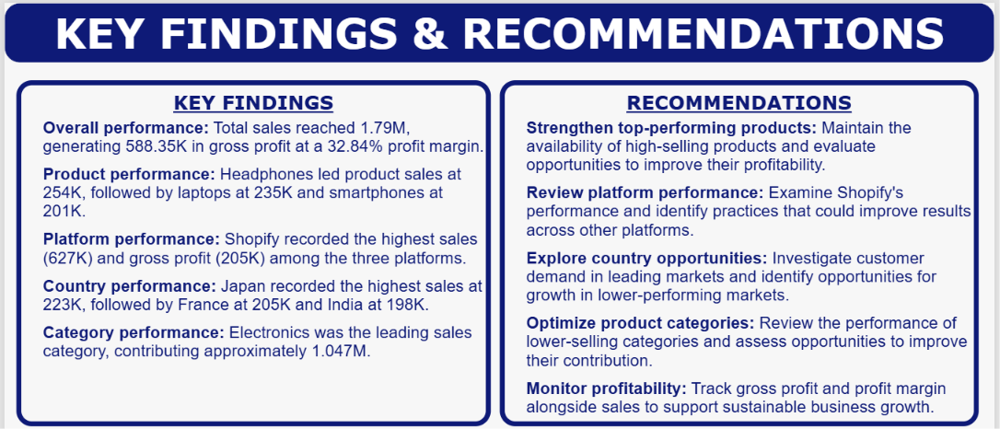

# E-Commerce Sales Dashboard | Power BI

## Project Overview

This project presents an interactive E-Commerce Sales Dashboard developed using Microsoft Power BI. It analyses sales performance, profitability, product performance, country-level sales and sales across different e-commerce platforms.

The dashboard provides an overview of business performance through key performance indicators (KPIs), interactive filters and visual reports. It helps identify sales trends and supports informed business decisions.

## Dashboard Preview



## Key Performance Indicators

| KPI | Result |
|---|---:|
| Total Sales | $1.79M |
| Gross Profit | $588.35K |
| Profit Margin | 32.84% |
| Total Orders | 1,000 |
| Units Sold | 6,490 |

## Dashboard Features

- **Top 10 Products by Sales:** Identifies the products generating the highest sales.
- **Sales by Category:** Shows sales distribution across product categories.
- **Country Performance:** Compares sales and profitability across countries.
- **Monthly Sales & Profit Trend:** Tracks monthly sales and profit performance.
- **Sales & Profit by Platform:** Compares Amazon, Shopify and eBay.
- **Global Sales Distribution:** Presents geographical sales distribution.

### Interactive Filters

Users can explore the dashboard using three slicers:

- Month
- Country
- Platform

## Key Findings

1. **Product Performance:** Headphones generated the highest sales at approximately 254K, followed by laptops at 235K and smartphones at 201K.
2. **Platform Performance:** Shopify recorded the highest sales, approximately 627K, and the highest gross profit, approximately 205K.
3. **Country Performance:** Japan recorded the highest sales at approximately 223K, followed by France at 205K and India at 198K.
4. **Category Performance:** Electronics was the leading product category, generating approximately 1.047M in sales.

## Recommendations

- Strengthen top-selling products while monitoring their profitability.
- Review Shopify's successful performance and identify practices that could improve other sales channels.
- Explore growth opportunities in leading and underperforming markets.
- Review lower-performing product categories.
- Monitor gross profit and profit margin alongside sales.

## Findings & Recommendations



## Dataset

The project uses an Excel dataset containing 1,000 e-commerce order records and 19 columns.

- **Period:** January–December 2026
- **Countries:** 10
- **Product categories:** 6
- **Individual products:** 30
- **Sales platforms:** Amazon, Shopify and eBay

The original dataset is available in the `dataset` folder.

## Tools Used

- Microsoft Power BI – Dashboard development and visualisation.
- Microsoft Excel – Source dataset.

## Project Structure

```text
E-Commerce-Sales-Dashboard/
├── README.md
├── dashboard/
│   └── dashboard.pbix
├── dataset/
│   └── Ecommerce_Sales_Dataset.xlsx
├── images/
│   ├── dashboard_overview.png
│   └── findings_recommendations.png
└── video/
    └── Ecommerce_Sales_Dashboard_Walkthrough.mp4
```

## Project Walkthrough

[Watch the E-Commerce Sales Dashboard Walkthrough](video/Ecommerce_Sales_Dashboard_Walkthrough.mp4)

Developed using Microsoft Power BI and Excel.

## 👤 Author

**Rachel Konadu Gyamfi**

Data Analytics Portfolio Project

[GitHub](https://github.com/)

